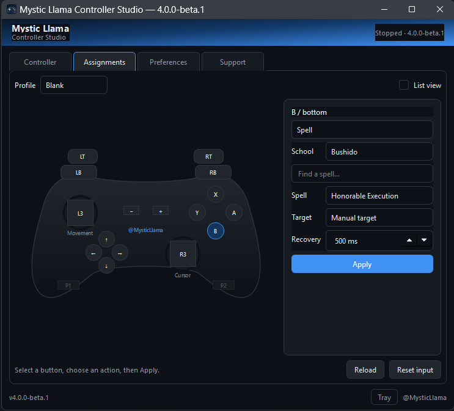

# Mystic Llama Controller Studio

**Use a gamepad to play Ultima Online on Windows with ClassicUO and Razor Enhanced.**

> [!IMPORTANT]
> **Public beta · v4.0.0-beta.1.** Controller layouts and game-input behavior can vary by device, driver, ClassicUO build and Razor Enhanced version. Try your movement, mouse and gameplay bindings in a safe in-game area before relying on them in combat.

*The Assignments tab shows a Blank profile with the bottom face button set to Honorable Execution, manual targeting and a 500 ms recovery.*

[Download the Windows beta](https://github.com/mystic-llama/uocontrollerbridge/releases/tag/v4.0.0-beta.1) · [Report a beta issue](https://github.com/mystic-llama/uocontrollerbridge/issues)

## What it does

Controller Studio brings character movement, the mouse pointer and frequently used UO actions to the same gamepad. Walk around Britannia with one stick, move the pointer with the other, and put the actions you reach for most on the buttons that feel natural to you. Start with a Caster or Dexxer preset, build a layout from Blank, or save your own in Custom.

The Windows app reads the controller and handles pointer and keyboard input. Its matching Razor Enhanced listener handles movement and native gameplay actions inside ClassicUO. Game actions follow the selected client window. Desktop pointer and mouse-button use outside UO is available as a preference.

| Feature | What you can do |
| --- | --- |
| **Movement and mouse** | Swap movement and cursor sticks, tune deadzones and cursor response, and set how far you push the movement stick to run. Assign left or right mouse buttons for clicking, double-clicking and holding to drag. |
| **Visual button assignments** | Click a control on the interactive gamepad diagram or use List view. Hover to see its assignment and watch the diagram highlight physical input. Map bumpers, triggers, stick clicks, D-pad directions, face buttons and rear paddles with independent inputs. |
| **Spells and abilities** | Choose from 137 entries across Magery, Chivalry, Necromancy, Bushido, Ninjitsu, Spellweaving and Mysticism. Set manual, self or last-target behavior and a recovery time for each spell binding. |
| **Combat, items and pets** | Bind actions such as Target Last, Attack Last, weapon specials, self-bandage and Use Last Item. Arm or disarm equipped hands, or give pets commands such as All Follow Me, All Guard Me and All Kill. |
| **Razor agents and shortcuts** | Control configured Razor agents such as AutoLoot, Scavenger, BandageHeal, Organizer and Restock. Record keyboard combinations that already trigger actions or macros in your ClassicUO or Razor Enhanced setup. |
| **Setup and recovery** | Learn your controller through guided calibration, recheck just the bumpers and triggers, and use Start, Pause, Stop or Reset input from the desktop. Support shows connection and input diagnostics. Preferences can enable the optional in-game assignment gump. |

## Install and connect

Use Windows 10 or 11 x64, a gamepad recognized by Windows, and ClassicUO with Razor Enhanced running inside the client. One selected client and character are controlled at a time.

1. From the [v4.0.0-beta.1 release](https://github.com/mystic-llama/uocontrollerbridge/releases/tag/v4.0.0-beta.1), choose **Windows Setup** for shortcuts or extract the **Windows portable ZIP** in full and open `ControllerStudio.exe`. Both builds include the desktop runtime.
2. Connect the controller and log in to UO. Open **Controller → Connection setup → Learn controller** and follow the prompts. Select your character's game window and click **Use this window**.
3. Click **Install / update Razor listener** and choose the parent scripts folder used by Razor Enhanced. In Razor, add `MysticLlamaController/razor_listener.py`, turn **Loop** off, and click **Play**.
4. In **Assignments**, select a profile, pick a control and choose its action. Click **Apply** to save. In **Controller**, click **Start**, then focus the selected game window to try your bindings.

For a first layout, try movement on the left stick, the cursor on the right, a left mouse assignment for targeting, and a frequently used spell or item on a face button. For Razor agent bindings, set up the agent's lists and containers in Razor Enhanced first.

## Upgrading and troubleshooting

Update the Windows app and reinstall its matching Razor listener. Controller Studio stores your saved profiles and device calibration in `%LOCALAPPDATA%\MysticLlama\ControllerStudio`. The 4.0 migration preserves your primary assignments and backs up the previous configuration.

| Symptom | What to check |
| --- | --- |
| A bumper fires when you move a stick, or a trigger reads incorrectly | Run **Controller → Connection setup → Check bumpers / triggers**. This relearns those four inputs while retaining the rest of your calibration and assignments. |
| The app sees the controller but an action does nothing in UO | Check the game and listener indicators, bring the selected game window to the foreground, and verify that the action works with your character or Razor configuration. Match the app's Windows privilege level to the game if mouse or keyboard input is blocked. |
| A rear paddle triggers a face button or bumper | Check your controller's software or firmware. Independent mapping depends on the paddle reporting a distinct input. |

When reporting a beta issue, include the Studio, ClassicUO and Razor Enhanced versions, your controller model and connection type, and the steps to reproduce it. **Support → Copy diagnostics** can help identify which input the app received.

## More information

- [Desktop assignments and calibration](docs/DESKTOP_ASSIGNMENTS.md)
- [Native Razor actions and requirements](docs/NATIVE_ACTIONS.md)
- [Windows build instructions](docs/BUILD_WINDOWS.md)
- [In-game validation checklist](docs/VALIDATION.md)

Created by **Mystic Llama**, building on the Controller Bridge refactored by Devin. The application source is available under the [MIT License](LICENSE). See [third-party notices](THIRD_PARTY_NOTICES.md) for bundled dependencies.
